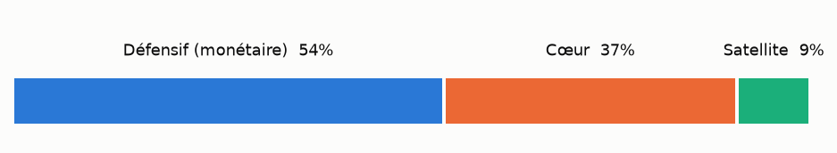
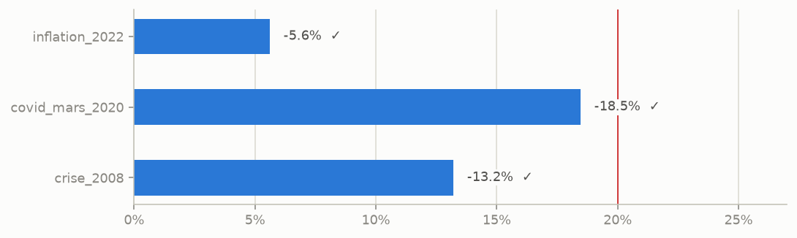
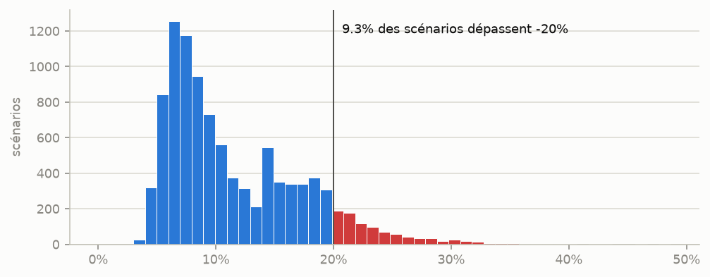
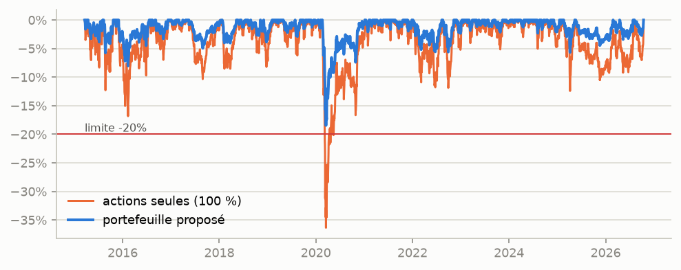

# Portfolio Copilot

Outil Python de construction de portefeuille d'actions et de gestion du risque, piloté par une politique d'investissement écrite.
Il part d'un univers d'indices, sélectionne des titres par des règles, choisit leurs poids sous contraintes et vérifie le risque de l'allocation avec des stress tests et une simulation Monte Carlo. Il produit ensuite un rapport HTML et un export Excel.

> **Lecture seule.** L'outil propose, l'humain décide. Il ne passe aucun ordre et n'est relié à aucun compte.
> Ce n'est pas un conseil en investissement. Toutes les mesures de risque sont estimées à partir du passé et **ne garantissent rien**.

Projet personnel (phase 1 terminée : script déterministe, sans IA générative).

---

## En une commande

```bash
conda env create -f environment.yml
conda activate portfolio-copilot
python scripts/run_screening.py       # propose une short-list (output/screening.xlsx)
python scripts/run_screening.py --valider   # après relecture humaine
python main.py                        # optimise et produit output/rapport.html + allocation.xlsx
pytest                                # 92 tests
```

`main.py` est découpé en cellules `# %%` pour être exécuté bloc par bloc dans VS Code.

---

## Ce que fait l'outil

```
config/policy.yaml ──► politique validée et figée
config/universe.csv ─► 271 titres (Euro Stoxx 50, FTSE 100, SMI, S&P 100)
        │
        ▼
  screening ──► short-list proposée ──► validation humaine (config/shortlist.csv, versionné)
        │
        ▼
  données Yahoo Finance (prix ajustés et dividendes, convertis en EUR, cache local)
        │
        ▼
  optimiseur ──► poids des actions (variance minimale sous contraintes)
             └─► plus grande part d'actions qui passe tous les contrôles de risque
        │
        ▼
  contrôles de politique (un verdict chiffré par règle)
        │
        ▼
  rapport HTML + Excel + explication rédigée par gabarit
```

### Exemple de résultat (octobre 2026, short-list proposée non validée)

L'allocation retenue place **46 % en actions** (21 lignes) et **54 % en fonds monétaire EUR**.

| Contrôle | Résultat | Limite |
|---|---|---|
| Stress test crise 2008 | -13,2 % | -20 % |
| Stress test Covid mars 2020 | -18,5 % | -20 % |
| Stress test inflation 2022 | -5,6 % | -20 % |
| P(baisse > 20 %) sur 5 ans, Monte Carlo | 9,3 % | 10 % |

Pour comparaison, la même sélection investie à 100 % en actions, en poids égaux, perdait 51 % en 2008 et 42 % en 2020.






---

## Politique d'investissement

Elle est définie dans [`config/policy.yaml`](config/policy.yaml), la seule source de vérité. Elle est chargée une fois, validée (cohérence entre les champs), puis figée : aucun module ne peut assouplir une limite en cours d'exécution.

| Règle | Valeur |
|---|---|
| Devise de base | EUR (le risque de change est inclus dans les calculs) |
| Horizon | 5 ans |
| Perte maximale tolérée | 20 % depuis le plus haut (max drawdown) |
| Univers | actions Europe + US |
| Exclusions | tabac, alcool, jeux d'argent |
| Structure | poche défensive (monétaire) + poche actions (80 % cœur dividendes / 20 % satellite IA et énergie) |
| Limites | ligne cœur ≤ 10 %, ligne satellite ≤ 5 %, secteur ≤ 30 %, pays ≤ 50 %, hors EUR ≤ 50 % |
| Règle d'acceptation | drawdown ≤ 20 % dans chaque stress test **et** P(drawdown > 20 %) ≤ 10 % en Monte Carlo |

**Pourquoi une poche défensive ?** La politique de départ ne prévoyait que des actions. Le module de risque a montré qu'un portefeuille 100 % actions perd 40 à 55 % dans une vraie crise, quels que soient les titres choisis. La limite de 20 % était donc impossible à tenir. Plutôt que de contourner la règle, la politique a été corrigée : **le risque se pilote d'abord par la part d'actions**, et l'optimiseur la choisit.

---

## Méthode

### 1. Univers
La composition de quatre indices publics est lue sur Wikipedia (`scripts/build_universe.py`). Le pays, le secteur et l'industrie viennent de Yahoo Finance. L'univers vient d'indices et non d'un choix manuel : la sélection repose ensuite uniquement sur des règles.

### 2. Screening ([`src/screener.py`](src/screener.py))
- **Poche** : fixée par l'industrie. Semi-conducteurs, pétrole et gaz, renouvelables → satellite ; le reste → cœur.
- **Filtres du cœur** :
  - rendement sur 12 mois ≥ 2 % ;
  - payout ≤ 80 % ;
  - dividende versé chaque année sur 5 ans ;
  - au plus une baisse du dividende de plus de 10 %, mesurée en devise locale pour qu'une baisse du dollar ne passe pas pour une coupe.
- **Dividendes exceptionnels** : un versement 1,5 fois plus gros que l'année précédente et qui ne se répète pas est ignoré. Sinon, il gonfle le rendement puis fait croire à une coupe l'année suivante. Exemples : Costco, Reckitt.
- **Score** : moyenne pondérée des rangs percentiles (rendement, payout, croissance du dividende, volatilité). On utilise des rangs parce que les critères n'ont pas la même unité, et qu'une valeur extrême ne peut ainsi pas écraser les autres.
- **Short-list** : les meilleurs scores, avec au plus 3 titres par secteur. Chaque titre écarté est listé avec sa raison.

### 3. Données ([`src/data.py`](src/data.py))
- **Prix ajustés** des dividendes et des splits, donc des rendements totaux.
- **Conversion en EUR** au taux du jour. Les cotations londoniennes en pence sont ramenées en livres.
- **Jours fériés** propres à une place : le dernier prix est reporté, au plus 5 jours de suite. Rien n'est inventé avant la première cotation d'un titre.
- **Variations de plus de 50 % en un jour** : signalées, jamais corrigées automatiquement.
- **Réseau** : cache local et réessais en cas de coupure. C'est le seul module qui dépend de yfinance.

### 4. Risque ([`src/risk.py`](src/risk.py))
| Mesure | Pourquoi |
|---|---|
| Volatilité annualisée | amplitude des variations |
| VaR historique 95 % | perte d'un « mauvais jour » (1 jour sur 20) |
| **CVaR (Expected Shortfall)** | perte moyenne au-delà de la VaR. La VaR dit où commence la queue de distribution, la CVaR dit à quel point elle est profonde. |
| VaR gaussienne | sert de comparaison : sur les données réelles, la VaR 99 % historique la dépasse, signe de queues épaisses |
| Max drawdown | la mesure de la politique, calculée depuis le plus haut (capital initial compris) |
| Stress tests | portefeuille actuel rejoué sur 2008, mars 2020 et 2022, avec la part du portefeuille couverte |
| **Monte Carlo par bootstrap par blocs** | 10 000 trajectoires de 5 ans, construites avec des blocs d'un mois tirés de l'historique. Garde les krachs réels et la volatilité en grappes, contrairement à une loi normale. |
| Contribution au risque | part de la variance due à chaque ligne : une ligne à 5 % du capital peut porter 8 % du risque |
| Concentration | poids par secteur, pays et devise, nombre de lignes effectives (1/Σw²) |

### 5. Optimisation ([`src/optimizer.py`](src/optimizer.py))
- **Poids des actions** : variance minimale sous toutes les contraintes de la politique. On n'utilise pas le ratio de Sharpe maximal : il exige des rendements attendus, très mal estimés à partir du passé, et l'optimiseur surpondérerait ce qui a le plus monté.
- **Covariance Ledoit-Wolf** : avec ~20 titres, la covariance brute contient du bruit que l'optimiseur exploite. Le shrinkage stabilise les poids. Une régularisation L2 évite de tout concentrer sur 3 lignes.
- **Part d'actions** : recherche par dichotomie de la plus grande part qui passe tous les contrôles. Le reste va au fonds monétaire. Si aucune part ne passe, le résultat est rendu « non conforme » : l'outil ne contourne pas une règle.

### 6. Contrôles et rapport ([`src/policy_check.py`](src/policy_check.py), [`src/report.py`](src/report.py))
Chaque règle produit un verdict chiffré : valeur, limite, respecté ou non. Un garde-fou vérifie que le Monte Carlo affiché dans le rapport est exactement celui qui a servi à décider.

### 7. Explication ([`src/explain.py`](src/explain.py))
Le texte est produit en deux temps. Le code extrait les chiffres et les constats, par exemple quelle règle limite la part d'actions ou si l'historique contient 2008. Un gabarit Jinja met ensuite ces faits en phrases. **Aucun chiffre du texte ne peut venir d'ailleurs que des calculs.**

---

## Hypothèses et limites

- **Le passé ne garantit rien.** Une crise d'une autre nature (taux, géopolitique, liquidité) peut faire pire que 2008, 2020 et 2022.
- **Historique du Monte Carlo** : il commence à la cotation du titre le plus récent, en 2015 dans l'exemple, et ne contient alors pas 2008. Le stress test 2008 compense en partie, et le rapport le signale.
- **Rendement moyen** : la probabilité de drawdown y est très sensible, alors que c'est le paramètre le moins bien estimé. Pendant la mise au point des tests, un écart de 0,01 %/jour sur ce rendement a fait passer la probabilité estimée de 29 % à 45 %.
- **Stress tests** : un titre non coté à l'époque est retiré et les autres poids sont remis à 100 %. La couverture est indiquée (87 % pour 2008 dans l'exemple).
- **Fonds monétaire avant 2008** : il n'est coté que depuis janvier 2008. Avant, son rendement est supposé nul, ce qui est prudent.
- **Rebalancement** : le portefeuille est supposé rebalancé chaque jour à poids constants, sans frais, impôts ni coûts de transaction.
- **Données** : Yahoo Finance via yfinance, source non officielle qui peut changer sans préavis. Le payout ratio vient de Yahoo. L'univers dépend de la composition des indices telle que publiée sur Wikipedia.
- **Biais du survivant** : l'univers contient les membres actuels des indices, qui ont par définition survécu jusqu'à aujourd'hui.
- **Volatilité, pas rendement** : l'optimisation minimise la volatilité et ne cherche pas à maximiser le rendement.

---

## Tests

92 tests, sans réseau : yfinance est remplacé par des données simulées. Chaque mesure de risque est d'abord testée sur une série dont on connaît le résultat exact, par exemple :
- 100 → 120 → 60 → 130 donne un max drawdown de 50 % ;
- deux actifs indépendants à 50/50 ont une volatilité divisée par √2 ;
- le bootstrap à blocs d'un jour est comparé à une simulation indépendante.

L'optimiseur est testé sur un marché simulé avec un krach connu de -50 % en 2008.

```bash
pytest
```

## Architecture

```
config/policy.yaml        politique d'investissement (source de vérité)
config/universe.csv       univers (généré par scripts/build_universe.py)
config/shortlist.csv      short-list validée par l'humain (versionnée)
src/policy.py             chargement, validation et gel de la politique
src/data.py               prix, dividendes, change, cache, nettoyage
src/screener.py           filtres, score, short-list
src/risk.py               mesures de risque
src/optimizer.py          poids et part d'actions
src/policy_check.py       contrôles de la politique
src/report.py             graphiques, HTML, Excel
src/explain.py            explication par gabarit
templates/                gabarits Jinja (rapport, explication)
scripts/                  construction de l'univers, screening
main.py                   enchaînement complet
tests/                    tests unitaires et de bout en bout
```

Chaque fonction de calcul prend des entrées claires et renvoie un résultat clair, sans effet de bord. C'est ce qui permettra en phase 2 de les exposer comme outils à un agent sans les réécrire.

## Suite

- **Phase 2** : les fonctions de calcul deviennent des outils (tool use) pour un agent basé sur l'API Claude. L'agent orchestre, propose des corrections et rédige. Les chiffres viennent toujours des outils, et la validation reste humaine. Viendront aussi des tests de robustesse (injection de prompt, hallucination de chiffres) et une cartographie AI Act.
- **Phase 3** : RAG sur rapports annuels et actualités, serveur MCP pour la couche de données, backtest puis paper trading avant tout usage réel.
